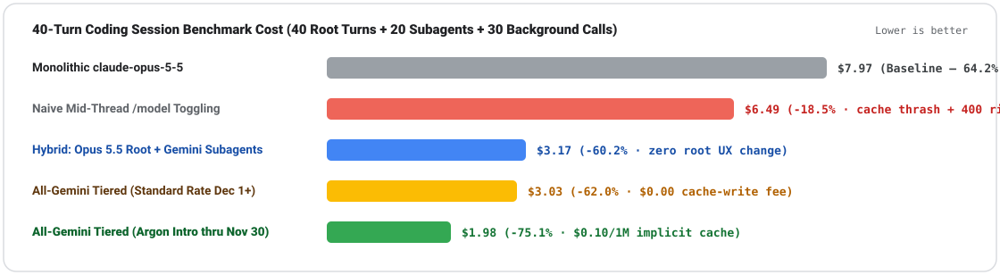
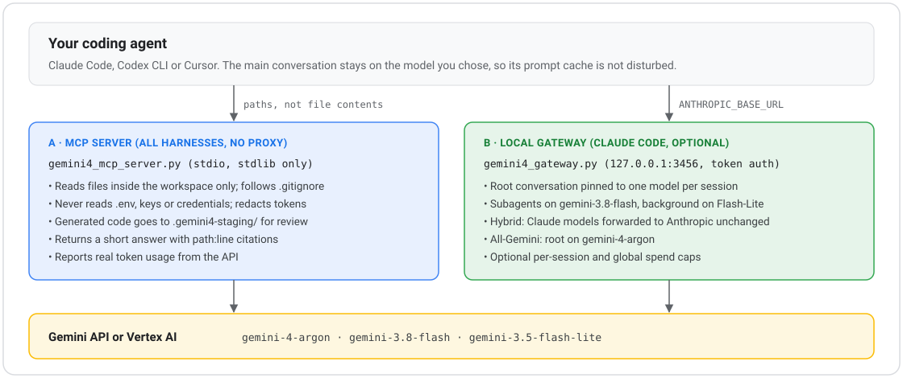

<div align="center">


<br />

[](https://github.com/vmishra/gemini4-harness-kit/actions/workflows/verify.yml)
[-4285F4)](./install.sh)
[](./verify.sh)
[](./README.md#per-harness-setup)
[](./LICENSE)

**Keep Claude Code, OpenAI Codex CLI, and Cursor IDE. Keep your root prompt cache warm.**  
Offload subagent exploration, 1M-token disk reads, and background loops to **Gemini 4 Argon**, **3.8 Flash**, and **3.5 Flash-Lite**—cutting session spend by **60.2% to 75.1%** with zero mid-thread provider switches.

[60-Second Quickstart](#60-second-quickstart) · [Why Coexistence](#why-coexistence) · [Architecture](#architecture) · [Per-Harness Setup](#per-harness-setup) · [MCP Tools](#file-pointer-mcp-tools) · [Security Guardrails](#security-privacy--spend-guardrails) · [Troubleshooting](#troubleshooting--protocol-reference)

</div>

---

## 60-Second Quickstart

**Option 1 — Direct Claude Code Plugin Install (`v2.1.275+`, Zero Proxy):**

```text
/plugin install gemini4-coexistence --marketplace vmishra/gemini4-harness-kit
```

**Option 2 — Full Multi-Harness Kit (Claude Code, Codex CLI, Cursor IDE & Local Smart Gateway):**

```bash
git clone https://github.com/vmishra/gemini4-harness-kit.git
cd gemini4-harness-kit

# 1. Read-only pre-flight check (Python 3.9+, loopback TCP, installed CLIs; never prints secrets)
./install.sh --doctor

# 2. Configure Google AI Studio (Paid Tier 1+) OR Vertex AI credentials
export GEMINI_API_KEY="AIzaSy..."
# Vertex AI alternative:
# gcloud auth application-default login && export GOOGLE_GENAI_USE_VERTEXAI="true" GOOGLE_CLOUD_PROJECT="your-project" GOOGLE_CLOUD_LOCATION="global"

# 3. Back up existing configs, install non-destructively, and run all 7 offline verification suites
./install.sh --all
./verify.sh
```

> [!IMPORTANT]
> **Google AI Studio Quota Note**: Free-tier frontier coding quota in AI Studio was retired in December 2025. Ensure your `GEMINI_API_KEY` belongs to a project with **Paid Tier 1+ billing** enabled, or authenticate via **Google Cloud Vertex AI** (`GOOGLE_GENAI_USE_VERTEXAI="true"`) for enterprise IAM, VPC-SC, and Zero Data Retention (ZDR).

---

## Why Coexistence?

In a standard 40-turn coding session on a monolithic frontier model (`claude-opus-5-5` at `$7.97/session`), **subagent repository exploration and test triage account for 64.2% of total token spend (`$5.12`)**—not top-level architectural planning.

Yet manually typing `/model` mid-session to switch to a cheaper model introduces two production failure modes:
1. **Prompt-Cache Thrashing**: Switching an active 120K-token root thread invalidates prefix cache locality and incurs a **`$5.00/1M` cache-write penalty** on Opus 5.5 upon re-entry—leaving naive toggling at `$6.49/session` (`-18.5%`) with cold-prefill latency spikes.
2. **Wire-Protocol Collisions (`HTTP 400`)**: Gemini and LiteLLM emit extended `tool_use.id` tokens and require cryptographic `thoughtSignature` replay on every tool turn. Switching a live tool thread back to Anthropic fails strict `^[a-zA-Z0-9_-]+$` validation.

<p align="center">
  
</p>

| Deployment Architecture | Root (40 Turns) | 20 Subagents | 30 Background | Session Total | Delta vs. Baseline |
|---|---:|---:|---:|---:|---|
| Monolithic `claude-opus-5-5` | `$2.25` | `$5.12` | `$0.60` | `$7.97` | Baseline |
| Naive mid-thread `/model` toggling | `$3.84` | `$2.35` | `$0.30` | `$6.49` | `-18.5%` (cache thrash + `400` risk) |
| **Track B1 — Hybrid (`Opus 5.5` Root + `Gemini` Subagents)** | `$2.25` | **`$0.87`** | **`$0.05`** | **`$3.17`** | **`-60.2%`** (zero root UX change) |
| **Track B2 — All-Gemini Tiered (`4-argon` intro thru Nov 30)** | **`$1.05`** | **`$0.87`** | **`$0.05`** | **`$1.98`** | **`-75.1%`** (`$0.10/1M` implicit cache) |
| **Track B2 — All-Gemini Tiered (standard rate Dec 1+)** | **`$2.11`** | **`$0.87`** | **`$0.05`** | **`$3.03`** | **`-62.0%`** (`$0.00` cache-write fee) |

---

## Architecture

`gemini4-harness-kit` never switches providers mid-thread on your active conversation. Instead, it keeps the **root planning thread pinned to a single model family** (`SESSION_PINS`) so its prefix cache remains warm, and delegates high-volume token work across **three isolated context boundaries**:

<p align="center">
  
</p>

| Model Tier | Availability | Context / Output | API Rate (In / Out) | Implicit Cache (`>=4,096` tok) | Speed | Assigned Harness Role |
|---|---|---|---|---|---|---|
| **`gemini-4-argon`** | **GA** | `1,048,576` / `65,536` | `$2 / $10` *(Intro)*<br>`$4 / $20` *(Dec 1+)* | **`$0.10 / 1M`** *(Intro, **`$0` write**)* | `~62 tok/s` | Root planner (All-Gemini), >150K disk synthesis, 64K migrations, CWE/CVE AppSec audits (tied **#1** Endor Labs Security League). |
| **`gemini-3.8-flash`** | **GA** | `1,048,576` / `65,536` | **`$0.75 / $3.75`** | **`$0.075 / 1M`** *(**`$0` write**)* | **`133 tok/s`** | **Subagent workhorse** (`89.4%` Terminal-Bench 2.1): repo exploration, grep/read loops, test triage, compaction (`-83%` subagent spend). |
| **`gemini-3.5-flash-lite`** | **GA** | `1,048,576` / `65,536` | **`$0.30 / $1.20`** | **`$0.03 / 1M`** *(**`$0` write**)* | **`454 tok/s`** | `ANTHROPIC_DEFAULT_HAIKU_MODEL` replacement: file indexing, commit titles, auto-mode safeguard checks. |
| **`gemini-4-carbon`** | **Fairwind** | `1,048,576` / `65,536` | Fairwind tier | Program tier | Deep reasoning | **1-line env-var ready** (`GEMINI4_FAIRWIND_CARBON_MODEL`): `#1` AA Intelligence v5.0 (`59`), `88.2%` SEC-bench Pro. |

---

## Choose Your Adoption Track

| Track | Best For | Proxy Needed? | Install Command | What Changes |
|---|---|---|---|---|
| **Track A: Zero-Proxy Plugin & Disk MCP** | Developers on **Claude Max OAuth** or **Cursor Pro/Business** subscriptions | **No** (`stdio` only) | `./install.sh --claude --cursor` | Preserves existing subscription transport; adds 1M-token disk-offload MCP tools, forked slash skills & custom subagents. |
| **Track B1: Hybrid Coexistence** *(Recommended)* | Teams on Anthropic API keys, Vertex/Bedrock, or **OpenAI Codex CLI** | **Yes** (`127.0.0.1:3456` or LiteLLM) | `./install.sh --all` | Keeps `claude-opus-5-5` as root planner; routes subagents to `3.8-flash` & Haiku loops to `3.5-flash-lite` (**`-60.2%` cost**). |
| **Track B2: All-Gemini Tiered** | Cost-sensitive engineering orgs & GCP Vertex AI environments | **Yes** (`127.0.0.1:3456` or LiteLLM) | `./install.sh --all` | Runs `4-argon` on root, `3.8-flash` on subagents, and `3.5-flash-lite` on background (**`-75.1%` intro / `-62.0%` standard**). |

---

## Per-Harness Setup

### 1. Claude Code (`v2.1.302+` & `v1.x` Fallback)

**Track A (Zero-Proxy — Keep Claude Max OAuth Subscription):**
```bash
./install.sh --claude
claude
# Inside Claude Code: verify `/mcp` shows `gemini4`, then run:
#   /gemini4-coexistence:bulk-test-triage
#   /gemini4-coexistence:gemini4-security-audit src/
```

**Track B (Local Smart Gateway + Automatic Subagent Role Pinning):**
```bash
# Start the zero-dependency gateway on 127.0.0.1:3456
# (For Hybrid mode live Opus root turns, also export ANTHROPIC_UPSTREAM_KEY="sk-ant-...")
python3 ./router/gemini4_gateway.py &

mkdir -p .claude
# Option B1 — Hybrid: Opus 5.5 Root + Gemini 3.8 Flash Subagents ($3.17/session, -60.2%)
cp ./claude/settings.hybrid-role-pinning.json .claude/settings.local.json

# Option B2 — All-Gemini Tiered: Argon 1M Root + 3.8 Flash Subagents ($1.98/session, -75.1%)
cp ./claude/settings.all-gemini-tiered.json .claude/settings.local.json

claude
```

---

### 2. OpenAI Codex CLI (`v0.134`–`v0.159+`)

Codex `v0.159+` requires `wire_api = "responses"` (`POST /v1/responses`) and sends OpenAI-specific fields (`store`, `prompt_cache_key`) rejected by raw Gemini endpoints. Start the local gateway and launch Codex with `--profile gemini4`:

```bash
./install.sh --codex
python3 ./router/gemini4_gateway.py &

# Primary Argon 1M profile (2-hour SSE reasoning idle timeout + explorer.toml -> 3.8-flash override)
codex --profile gemini4

# Fast 133 tok/s interactive coding on Gemini 3.8 Flash
codex --profile gemini4 --model claude-gemini-3.8-flash

# Read-only CWE/CVE security audit in headless mode
codex exec --profile gemini4-security "Audit src/ for auth bypass, SSRF, and SQL injection"
```

---

### 3. Cursor IDE (Post-Oct 2026 Pricing & Subagents)

```bash
./install.sh --cursor
```

1. Open `./install.sh --cursor` output and click the generated `cursor://anysphere.cursor-deeplink/mcp/install?...` URI (or let `install.sh` populate `~/.cursor/mcp.json` automatically).
2. In Cursor Composer (`Cmd+I`), set **Plan** mode (`Shift+Tab`) to an explicit parent model (`gemini-4-argon` or `claude-opus-5-5`—**do not** leave the parent dropdown on `Auto` or `Grok`, per Cursor Forum Issue `#176256`).
3. Invoke `/gemini4-explorer` (runs on `gemini-3.8-flash`, **exempt** from Cursor's Oct 2026 `$0.25/1M` Token Rate surcharge), `/gemini4-security-auditor`, or `/gemini4-migrator`.

---

### 4. Enterprise LiteLLM (`v1.109+`) & `claude-code-router` (CCR)

Teams standardizing on central API gateways can deploy [`router/litellm/litellm_config.yaml`](./router/litellm/litellm_config.yaml) on Cloud Run / GKE or stage our CCR worker via `./install.sh --ccr`:

```bash
litellm --config ./router/litellm/litellm_config.yaml --port 4000
```

---

## File-Pointer MCP Tools

Instead of copying 300K+ tokens of raw files into your root chat transcript (and paying to re-read them on every subsequent turn), `gemini4_mcp_server.py` accepts **local file/directory paths**, reads them straight off disk into Gemini's 1.05M context window (hitting Google's 90%–95% implicit cache on follow-ups), and returns a `<500`-word synthesis:

| MCP Tool | Default Tier | Purpose |
|---|---|---|
| `gemini4_analyze_codebase` | `gemini-3.8-flash` / `4-argon` | Ingests `paths[]` from disk and returns architectural summaries, call-graph traces, or root-cause analysis without bloating root context. |
| `gemini4_security_audit` | `gemini-4-argon` *(or Fairwind Carbon)* | Performs deep CWE/CVE taint-flow analysis across `paths[]` with structured severity, file/line evidence, and remediation diffs. |
| `gemini4_long_decode_refactor` | `gemini-4-argon` (`65,536` out) | Generates complete multi-file migrations/refactors (`maxOutputTokens=65536`) into `.gemini4-staging/` for clean `git diff` review. |
| `ask_antigravity` | `agy -p --add-dir` / `4-argon` | Cross-family architectural critique & pre-commit review via Google Antigravity CLI (with automatic stdlib REST/Vertex fallback). |
| `gemini4_antigravity_task` | `gemini-4-argon` | Delegates autonomous multi-step verify-and-fix engineering tasks in an isolated context. |
| `gemini4_cache_telemetry` | Local state (`0` tokens) | Reports active implicit-cache warmth and estimated session dollar savings vs. monolithic `claude-opus-5-5`. |

---

## Security, Privacy & Spend Guardrails

- **Credential Isolation (`apiKeyHelper`)**: On shared workstations, deliver gateway tokens via a `0600`-permissioned helper script (`"apiKeyHelper"` in `settings.local.json`) so raw keys never enter child tool environments. `./install.sh --doctor` prints variable *names* only (never values) and warns if `CLAUDE_CODE_PROVIDER_MANAGED_BY_HOST=1` is set (which disables `apiKeyHelper` in Claude Code `v2.1.283+`).
- **Zero-Prompt Telemetry**: `gemini4_gateway.py` never logs raw prompt text—`/health` and `ROUTING_TRACES` record only a 16-hex SHA-256 `prompt_digest` and token counts.
- **Risk-Word Routing Floor (`RISK_WORDS_RE`)**: In dynamic `claude-auto-gemini` mode, short prompts matching operational or security risk stems (`production`, `security`, `auth`, `crypto`, `migration`, `payment`, `delete`, `drop table`, `secret`, `cve`, `cwe`) are barred from downgrading to `gemini-3.5-flash-lite`.
- **Per-Session Spend Cap**: Export `GEMINI4_SESSION_BUDGET_USD="5.00"` on the gateway to halt runaway agent loops cleanly with a structured `HTTP 403` error envelope.

---

## Troubleshooting & Protocol Reference

<details>
<summary><strong>Gateway 9-Rule Deterministic Routing Pipeline (<code>classify_and_route</code> · &lt;1 ms)</strong></summary>

<br />

| Priority | Rule | Trigger | Routed Target | Cache Impact |
|---:|---|---|---|---|
| **1** | `ccr_subagent_tag` | `<CCR-SUBAGENT-MODEL>...</CCR-SUBAGENT-MODEL>` | Specified Gemini tier | Zero parent impact (isolated) |
| **2** | `context_management_compaction_flash` | `context_management` / `is_summary` | `gemini/gemini-3.8-flash` | Out-of-band compaction |
| **3** | `background_haiku_flash_lite` | Model contains `haiku` or `3.5-flash-lite` | `gemini/gemini-3.5-flash-lite` | Isolated background role |
| **4** | `single_family_complexity_router` | Model is `claude-auto-gemini` | `4-argon` (`>150K` / CWE / migration), `3.5-lite` (`<140c`, Turn ≤2, zero risk words), else `3.8-flash` | Single-family Gemini implicit cache |
| **5** | `explicit_gemini_role_or_agent` | Explicit `gemini-4-argon` / `3.8-flash` | Requested Gemini model | Pins root if `subagent_flag=False` |
| **6** | `sticky_quota_failover_429` | Upstream returns `HTTP 429` | `gemini/gemini-4-argon` (sticky-pinned) | Prevents cross-provider flap penalty |
| **7** | `subagent_*` | `subagent_flag=True` | `4-argon` on CWE / `>150K`, else `3.8-flash` | Zero parent impact (isolated) |
| **8** | `session_pinned_cache_guard` | Root thread `turn > 2` in `SESSION_PINS` | Previously pinned root model | **100% root prefix cache preserved** |
| **9** | Turn-1 Root Classification | Fresh root thread (`turn <= 2`) | `4-argon` if `>150K` / CWE / migration, else default root | Locked from Turn 1 onward |

</details>

<details>
<summary><strong>7-Suite Offline Verification Matrix (<code>./verify.sh</code>)</strong></summary>

<br />

Runs completely offline in `<5s` on stock macOS `/usr/bin/python3` (`3.9.6`) through Python `3.13+`:

| Suite | Scope Verified |
|---|---|
| `[1/7]` | Claude Code plugin & marketplace schemas (`claude plugin validate`), `ANTHROPIC_API_KEY=""` precedence, `ENABLE_TOOL_SEARCH="false"` |
| `[2/7]` | Codex `v0.159+` `wire_api = "responses"`, `stream_idle_timeout_ms = 7200000`, `explorer.toml` override, Argon subagent TOMLs |
| `[3/7]` | Cursor `.cursor-plugin/plugin.json`, subagent frontmatter, Oct 2026 `$0.25/1M` exemption & Issue `#176256` rule |
| `[4/7]` | `claude-code-router` (CCR) Node.js worker (`3.5-flash-lite`, `3.8-flash`, `4-argon` routing) |
| `[5/7]` | Stdio MCP JSON-RPC 2.0 handshake, all 6 tools (`ask_antigravity`, `gemini4_*`), `[1m]` normalization, warm implicit-cache tracking |
| `[6/7]` | Gateway `/model` substring discovery (`claude-gemini-*`), `--permission-mode auto` `safeguard_results`, root session pinning, HTTP `429` sticky failover |
| `[7/7]` | Claude `v2.1.301+` embedded `role: "system"` extraction, `/anthropic/v1/messages/count_tokens`, `/openai/v1/responses` field stripping, `RISK_WORDS` floor, `GEMINI4_SESSION_BUDGET_USD` `403` cap, `--doctor --json` |

</details>

<details open>
<summary><strong>Late-2026 Harness Nuances &amp; Built-In Mitigations</strong></summary>

<br />

| Symptom / Version Nuance | Root Cause | Built-In Mitigation |
|---|---|---|
| **Claude Code `/model` menu omits Gemini models** | Claude Code `v2.1.302+` filters out gateway model IDs that do not contain `claude` or `anthropic`. | Gateway & LiteLLM expose `claude-gemini-4-argon`, `claude-gemini-3.8-flash`, `claude-gemini-3.5-flash-lite`, and `claude-auto-gemini`. |
| **Claude Code searches for `Bash`/`Write` instead of calling them** | Deferred tool search assumes Anthropic-native tool-search blocks on non-Anthropic primary models. | `claude/settings.all-gemini-tiered.json` sets `"ENABLE_TOOL_SEARCH": "false"`. |
| **Claude Code `v2.1.301+` sends `role: "system"` inside `messages[]`** | Hook messages are injected mid-array with `role: "system"`, which Gemini rejects inside `contents[]`. | `gemini4_gateway.py` extracts mid-array `role: "system"` items and merges them into `systemInstruction`. |
| **Claude Code logs `404`/`502` twice per turn on custom gateways** | Claude Code preflights `POST /v1/messages/count_tokens` twice per turn. | `gemini4_gateway.py` implements `/v1/messages/count_tokens` across `system`, `tools`, and `messages`. |
| **Gemini 3.8 / 4 returns `400` on multi-turn tool calls** | Claude strips unknown fields like `thoughtSignature` from `tool_use` history blocks. | Bounded 512-entry LRU `THOUGHT_SIGNATURE_VAULT` replays signatures and attaches `skip_thought_signature_validator` on unrecorded first calls. |
| **Codex CLI fails directly against `googleapis.com/v1beta/openai`** | Codex `v0.159+` removed `/chat/completions` (`wire_api = "responses"` mandatory) and sends `store` / `prompt_cache_key`. | `codex/gemini4.config.toml` routes via `127.0.0.1:3456/v1` and strips unsupported OpenAI fields automatically. |
| **Headless `agy -p` (`v1.4.7+`) exits `0` without writing files** | Requires `"modelProvider": "gemini"` in `~/.gemini/antigravity-cli/settings.json` and soft-denies headless writes (`denied_actions`) without `permissions.allow`. | Read-only `ask_antigravity` runs unaffected; `--doctor` and `gemini4_mcp_server.py` detect `denied_actions` and print the exact rule. |
| **`HTTP 404` when requesting `gemini-4-carbon`** | **Gemini 4 Carbon** (Oct 28, 2026) is gated to Google Cloud's **Fairwind** program. | Defaults to GA `gemini-4-argon` today; set `GEMINI4_FAIRWIND_CARBON_MODEL` once enrolled in Fairwind. |

</details>

<details>
<summary><strong>Repository Layout</strong></summary>

<br />

```text
gemini4-harness-kit/
├── .github/workflows/verify.yml       # Hermetic CI matrix (Ubuntu & macOS · Python 3.9–3.13)
├── assets/                            # Vector architecture & benchmark SVGs
├── LICENSE                            # Apache License 2.0
├── README.md                          # Architecture, quickstart & troubleshooting guide
├── install.sh                         # Idempotent installer + read-only `--doctor [--json]` + `--dry-run`
├── verify.sh                          # 7-suite hermetic verification runner (Python 3.9–3.13+)
├── .claude-plugin/marketplace.json    # Claude Code v2.1+ Marketplace manifest
├── .cursor-plugin/plugin.json         # Cursor IDE plugin manifest
├── claude/
│   ├── settings.hybrid-role-pinning.json   # Opus 5.5 Root + Gemini 3.8 Flash Subagents (-60.2%)
│   └── settings.all-gemini-tiered.json     # All-Gemini Tiered Stack (-75.1%, ENABLE_TOOL_SEARCH=false)
├── plugins/gemini4-coexistence/
│   ├── .claude-plugin/plugin.json     # Plugin v1.1.0 manifest & interactive userConfig
│   ├── .mcp.json                      # Stdio MCP configuration
│   ├── mcp/gemini4_mcp_server.py      # Zero-dependency File-Pointer MCP + `ask_antigravity` bridge
│   ├── skills/                        # `gemini4-coexistence`, `bulk-test-triage`, `gemini4-security-audit`
│   └── agents/                        # `gemini-codebase-explorer`, `argon-security-auditor`, `gemini-worktree-builder`
├── router/
│   ├── gemini4_gateway.py             # Local HTTP gateway (:3456) for Claude Code, Codex & Cursor
│   ├── litellm/litellm_config.yaml    # Enterprise LiteLLM v1.109.0+ configuration
│   └── ccr/                           # `musistudio/claude-code-router` worker & profiles
├── codex/
│   ├── AGENTS.md                      # Repo-scoped Codex delegation instructions
│   ├── gemini4.config.toml            # Codex Responses API profile (`codex --profile gemini4`)
│   ├── gemini4-security.config.toml   # Read-only CWE/CVE audit profile
│   └── agents/                        # `explorer.toml` override, `argon-reviewer.toml`, `argon-migrator.toml`
└── cursor/
    ├── mcp.json                       # Cursor MCP template
    ├── rules/gemini4-coexistence.mdc  # Post-Oct 2026 surcharge exemption & Issue #176256 rules
    └── agents/                        # `gemini4-explorer.md`, `gemini4-security-auditor.md`, `gemini4-migrator.md`
```

</details>

---

## License

Licensed under the [Apache License 2.0](./LICENSE).
