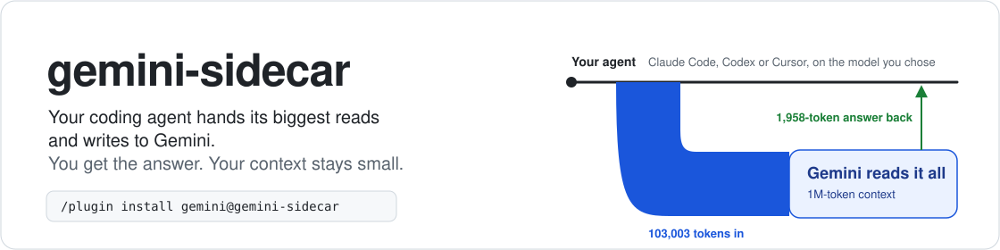
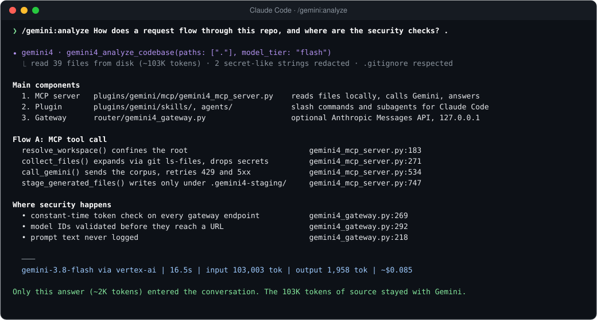
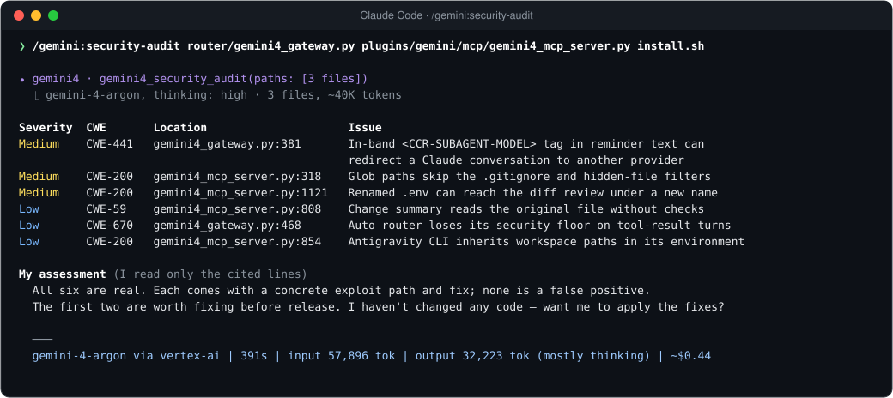
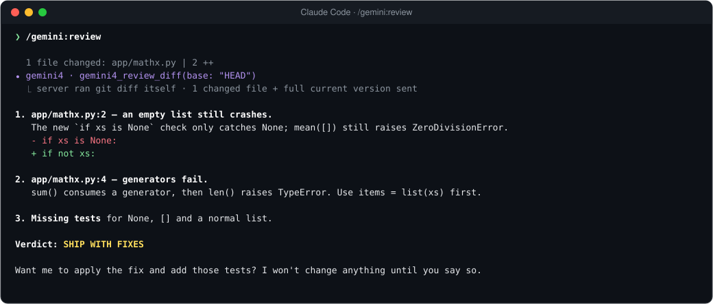
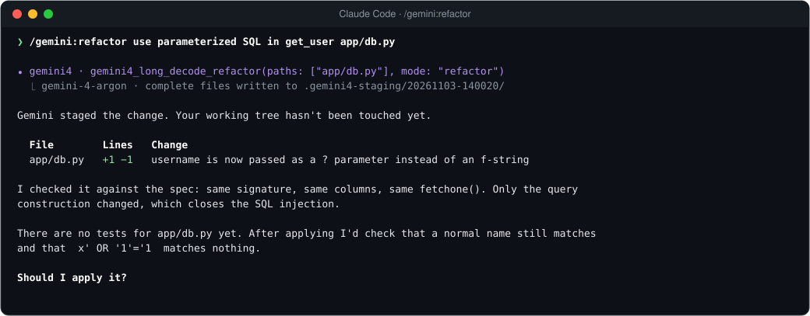
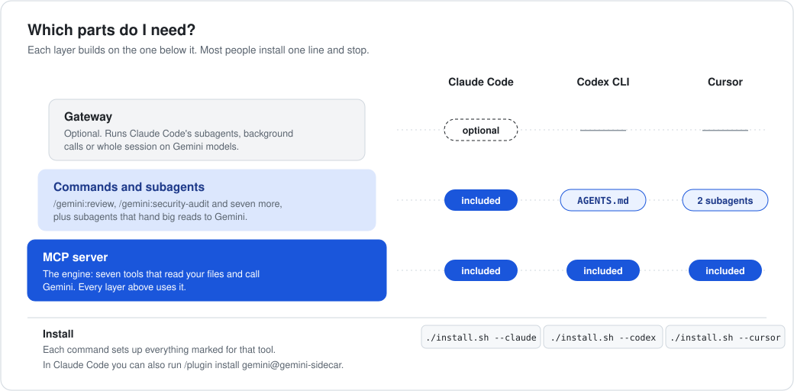

<div align="center">



[](https://github.com/vmishra/gemini4-harness-kit/actions/workflows/verify.yml)
[](./verify.sh)
[](./LICENSE)

**Your coding agent hands its biggest reads and writes to Gemini. You get the answer; your context stays small.**

</div>

<p align="center">
  
</p>

One command read this entire repository, 39 files and 103K tokens, and returned a cited answer in 16.5 seconds for $0.085. Claude never loaded the files.

## Try it in two minutes

In Claude Code:

```text
/plugin marketplace add vmishra/gemini4-harness-kit
/plugin install gemini@gemini4-harness-kit
```

Give it Gemini access, either way:

```bash
export GEMINI_API_KEY=...            # a key from Google AI Studio
# or, on Google Cloud:
gcloud auth application-default login
export GOOGLE_GENAI_USE_VERTEXAI=true GOOGLE_CLOUD_PROJECT=my-project
```

Restart Claude Code, then run `/gemini:status` to confirm, and `/gemini:analyze what does this repo do? .` to see it work.

Using Codex CLI or Cursor instead? See [Codex and Cursor](#codex-cli-and-cursor).

## What you can type

| Command | Use it when you want to… | Example |
|---|---|---|
| `/gemini:analyze` | understand code that is too big to read yourself | `/gemini:analyze how is auth enforced across services? src/ api/` |
| `/gemini:security-audit` | find vulnerabilities, with CWE IDs and exact lines | `/gemini:security-audit` (audits your uncommitted changes) |
| `/gemini:review` | get a second reviewer before you commit or open a PR | `/gemini:review main` |
| `/gemini:refactor` | make a large, multi-file change you can review first | `/gemini:refactor migrate src/db from callbacks to async/await` |
| `/gemini:test-gen` | write tests that match your project's style | `/gemini:test-gen src/billing/invoice.py` |
| `/gemini:test-triage` | find out why tests fail without pasting the log | `/gemini:test-triage pytest -x` |
| `/gemini:docs` | add or fix docstrings and docs without touching behaviour | `/gemini:docs src/utils/` |
| `/gemini:ask-antigravity` | challenge the current plan before you commit to it | `/gemini:ask-antigravity is a queue overkill here?` |
| `/gemini:status` | check setup and see tokens and cost so far | `/gemini:status` |

Options: `--deep` on `analyze` uses `gemini-4-argon` instead of `gemini-3.8-flash`. `--fast` on `review` does the opposite. `--staged` reviews only staged changes. `--focus "<area>"` narrows an audit. If no other plugin uses the same name, you can drop the prefix and type `/review`.

### What it looks like

<p align="center">
  
</p>

This is `/gemini:security-audit` run on this repository's own code. It found six real issues that two earlier code reviews had missed, and all six are fixed in [`038b827`](../../commit/038b827). Claude then checks each finding against the cited lines before you act.

<table>
<tr>
<td width="50%"></td>
<td width="50%"></td>
</tr>
<tr>
<td><code>/gemini:review</code> runs <code>git diff</code> itself and ends with a verdict: SHIP, SHIP WITH FIXES, or DO NOT SHIP.</td>
<td><code>/gemini:refactor</code> writes complete files to a staging folder. Nothing in your tree changes until you say yes.</td>
</tr>
</table>

<sub>Screenshots are real Gemini output from runs on this repository and a small test project, trimmed to fit. Claude's closing remarks are condensed.</sub>

## How it works

<p align="center">
  
</p>

Your agent sends **paths**, not file contents. A small server on your machine reads the files, drops anything secret, and sends the rest to Gemini's 1M-token context. Only Gemini's answer comes back. The files never pass through your agent's context window, so they don't crowd out your conversation or get re-billed on every later turn.

## Which parts do I need?

<p align="center">
  
</p>

**Most people need only the first install line for their tool.** The terms, in plain language:

<dl>
<dt>MCP server</dt>
<dd>The engine. A single Python file that gives your agent seven tools: analyze, security audit, review diff, refactor, triage failures, ask Antigravity, and status. MCP (Model Context Protocol) is the standard way coding agents call external tools, so Claude Code, Codex CLI and Cursor can all use it. You never call it directly; your agent does.</dd>

<dt>Commands</dt>
<dd>The <code>/gemini:…</code> slash commands in Claude Code. Each is a short recipe that tells Claude which tool to call, with what, and what to do with the answer. For example, it verifies findings, and it asks before applying changes.</dd>

<dt>Subagents</dt>
<dd>Helpers Claude can hand a task to so the main conversation stays focused. The plugin adds <code>gemini-explorer</code> (answers "where is X?" questions by sending big directories to Gemini) and <code>gemini-implementer</code> (builds a large change in a separate git worktree, then runs your tests). Claude uses them when it judges they fit. You can also ask: "use gemini-explorer to find where retries are configured".</dd>

<dt>Gateway</dt>
<dd>Optional, and only for Claude Code. It runs Claude Code itself on Gemini models: just the subagents and background calls (Hybrid), or the whole session (All-Gemini). You don't need it for the commands. See <a href="#the-gateway-optional">the gateway</a>.</dd>
</dl>

## Measured, not estimated

Every run below was made on 3 November 2026 against Vertex AI. Costs use November 2026 list prices.

| Run | Model | Read | Answer | Time | Cost |
|---|---|---:|---:|---:|---:|
| `/gemini:analyze` on this whole repository (39 files) | `gemini-3.8-flash` | 103,003 tok | 1,958 tok | 16.5 s | $0.085 |
| Follow-up question, same files | `gemini-3.8-flash` | 102,988 tok | 573 tok | 8.0 s | $0.079 |
| `/gemini:security-audit` on 3 core files (~3,100 lines) | `gemini-4-argon` | 57,896 tok | 32,223 tok\* | 391 s | $0.44 |
| `/gemini:refactor` with tests, small project | `gemini-4-argon` | 384 tok | 2,817 tok | 45 s | $0.029 |
| `/gemini:review` of an uncommitted change | `gemini-3.8-flash` | 280 tok | 1,984 tok | 16 s | $0.008 |
| `/gemini:test-triage` of a failing suite | `gemini-3.8-flash` | 415 tok | 332 tok | 3.9 s | $0.002 |

\*Mostly reasoning tokens. Audits and refactors on `gemini-4-argon` think hard and can take several minutes. Analysis and triage on Flash take seconds.

`/gemini:status` shows the same figures for your own session, taken from the API's usage data.

**What the first row saves.** If Claude Opus 5.5 read those 103K tokens itself, they would be written to its prompt cache once ($0.52 at $5 per 1M) and re-read on every later turn ($0.02 per turn at $0.20 per 1M). Over a 30-turn session that's about $1.13, plus half of a 200K context window used up. Through this kit it's $0.085, and the conversation grows by 2K tokens. Token counts here are Gemini's; Claude's tokenizer counts somewhat differently.

## Codex CLI and Cursor

Both get the same seven tools through the MCP server. The harness keeps its own model, and asks Gemini when a task needs a big read or a long write.

```bash
git clone https://github.com/vmishra/gemini4-harness-kit.git && cd gemini4-harness-kit
./install.sh --codex     # adds [mcp_servers.gemini4] to ~/.codex/config.toml
./install.sh --cursor    # adds gemini4 to ~/.cursor/mcp.json, installs two read-only subagents
```

Then ask in plain language: "use gemini4_security_audit on src/auth", or "review my diff with gemini4_review_diff". For Codex, copy [`codex/AGENTS.md`](./codex/AGENTS.md) into your project so it knows when to reach for the tools. For Cursor, copy [`cursor/rules/gemini4-coexistence.mdc`](./cursor/rules/gemini4-coexistence.mdc) into `.cursor/rules/`.

`install.sh` backs up every file it changes (`<file>.bak.<timestamp>`), supports `--dry-run`, and `./install.sh --doctor` checks your setup without printing any secret.

## The gateway (optional)

<p align="center">
  
</p>

Claude Code sends three kinds of model requests: your main conversation, its subagents, and small background calls. The gateway is a local server that receives them (Claude Code points at it through `ANTHROPIC_BASE_URL`) and sends each one to the model in the table above.

- **Hybrid** keeps Claude Opus 5.5 for your conversation and moves the high-volume work to Gemini. It needs an Anthropic API key for the forwarded requests.
- **All-Gemini** runs everything on Gemini and needs only Gemini credentials.

Either way, a conversation stays on one model from start to finish. Switching models midway would throw away the prompt cache, and Claude and Gemini tool-call histories are not interchangeable.

```bash
# Terminal 1: start the gateway (the first start creates a private token in ~/.config/gemini4/)
export GOOGLE_GENAI_USE_VERTEXAI=true GOOGLE_CLOUD_PROJECT=my-project   # or GEMINI_API_KEY=...
export ANTHROPIC_UPSTREAM_KEY=sk-ant-...                                # Hybrid only
python3 router/gemini4_gateway.py

# Terminal 2: point a project at it and start Claude Code
./install.sh --gateway-profile all-gemini --project ~/code/my-app       # or: hybrid
cd ~/code/my-app && claude
```

Tested end to end with Claude Code on the All-Gemini profile: multi-step read, edit and test tasks completed, subagents ran on `gemini-3.8-flash`, and Gemini's automatic caching showed in the usage data. Limitations:
- Only Claude Code's API (Anthropic Messages) is implemented.
- Gemini replies arrive in one piece rather than streaming word by word.
- Spend caps (`GEMINI4_SESSION_BUDGET_USD`, `GEMINI4_GLOBAL_BUDGET_USD`) are estimates held in memory.

## Pricing

November 2026 list prices, USD per 1M tokens, Standard tier:

| Model | Input | Cached input | Output (incl. thinking) | Used for |
|---|---:|---:|---:|---|
| `gemini-4-argon` | $2.00 | $0.10 | $10.00 | audits, reviews, refactors, `--deep` analysis |
| `gemini-3.8-flash` | $0.75 | $0.075 | $3.75 | analysis, triage, subagents |
| `gemini-3.5-flash-lite` | $0.30 | $0.03 | $2.50 | gateway background calls |
| `claude-opus-5-5`, for comparison | $4.00 | $0.20 (writes $5.00) | $20.00 | Hybrid main conversation |

Scheduled changes:
- `gemini-4-argon`'s introductory price ends on 30 Nov 2026; from 1 Dec it is $4 / $0.20 / $20.
- `gemini-3.8-flash` moves to $1.50 / $0.15 / $7.50 on 1 Jan 2027.

Gemini caches repeated prompt prefixes automatically, with no write fee. The minimum prefix is 4,096 tokens for `gemini-4-argon` on the Gemini API (6,144 on Vertex AI) and 1,024 for Flash models. Cache hits are not guaranteed.

Sources: [Gemini API pricing](https://aistudio.google.com/docs/pricing), [Gemini 4 Argon announcement](https://blog.google/innovation-and-ai/models-and-research/gemini-models/gemini-4-argon/), [Claude pricing](https://platform.claude.com/docs/en/about-claude/pricing), [Gemini caching minimums](https://firebase.google.com/docs/ai-logic/context-caching).

Flash and Flash-Lite also have a free tier on the Gemini API, but Google may use free-tier data to improve its products. Use a paid key or Vertex AI for proprietary code.

## What leaves your machine

File contents go to the Gemini API, or to Vertex AI in your own Google Cloud project, only when a tool runs. Before anything is sent:

- **Only your project.** Paths must resolve inside the project directory. Absolute paths elsewhere, `..`, and symlinks pointing outside are rejected. Your home directory or `/` can't be used as the project.
- **Only what git would commit.** Inside a git repository, folders are expanded with `git ls-files`, so anything in `.gitignore` is skipped.
- **Never secrets.** Files such as `.env*`, `*.pem`, `*.key`, SSH keys, `credentials*`, `*.tfstate`, `.npmrc`, `.netrc`, `.pgpass` and `.git/` are never read. Tokens for Google, AWS, GitHub, Slack, Stripe, OpenAI and Anthropic, plus private keys and JWTs, are redacted from whatever is sent. Each answer reports what was excluded or redacted.
- **No surprise edits.** Generated code goes only to `.gemini4-staging/<run>/`, which is git-ignored. Paths into `.git/` and symlinked staging folders are refused.
- **Antigravity sees copies only.** When `/gemini:ask-antigravity` uses the Antigravity CLI, `agy` runs in a temporary folder holding redacted copies of the approved files, with a cleaned environment.

The gateway listens only on `127.0.0.1`, requires a token, rejects browser requests (any `Origin` header, unexpected `Host`), and never logs prompt text.

## Reference

<details>
<summary><strong>The seven MCP tools</strong></summary>

| Tool | Does | Default model |
|---|---|---|
| `gemini4_analyze_codebase` | Answers a question over files, directories or globs | `gemini-3.8-flash` (`model_tier: "pro"` for `gemini-4-argon`) |
| `gemini4_security_audit` | Findings table: severity, CWE, `path:line`, exploit path, fix | `gemini-4-argon` |
| `gemini4_review_diff` | Reviews `git diff` against a base ref; ends with a verdict | `gemini-4-argon` |
| `gemini4_long_decode_refactor` | Writes complete files to `.gemini4-staging/` (`mode`: refactor, tests, docs) | `gemini-4-argon`, up to 65,536 output tokens |
| `gemini4_triage_failures` | Root-causes failures from a saved log plus source files | `gemini-3.8-flash` |
| `ask_antigravity` | Independent critique; uses `agy` in read-only plan mode when enabled | `gemini-4-argon` |
| `gemini4_status` | Configuration, token usage and cost for the session | none |

</details>

<details>
<summary><strong>Configuration</strong></summary>

| Variable | Purpose |
|---|---|
| `GEMINI_API_KEY` / `GOOGLE_API_KEY` | Gemini API key. In Claude Code you can store it with `/plugin configure gemini@gemini4-harness-kit` |
| `GOOGLE_GENAI_USE_VERTEXAI`, `GOOGLE_CLOUD_PROJECT`, `GOOGLE_CLOUD_LOCATION` | Use Vertex AI (location defaults to `global`) |
| `GEMINI4_PRIMARY_MODEL`, `GEMINI4_SUBAGENT_MODEL`, `GEMINI4_BACKGROUND_MODEL` | Override the pro, flash and flash-lite models |
| `GEMINI4_SECURITY_MODEL` | Model for audits, if different from the pro model |
| `GEMINI4_WORKSPACE_ROOT` | Folder the server may read (default: the project directory) |
| `GEMINI4_MAX_CONTEXT_CHARS`, `GEMINI4_MAX_FILES`, `GEMINI4_MAX_FILE_BYTES` | Per-call limits (2.4M chars, 1,500 files, 1 MB per file) |
| `GEMINI4_REQUEST_TIMEOUT` | Seconds per Gemini call (default 900) |
| `GEMINI4_ENABLE_AGY_CLI=1` | Let `/gemini:ask-antigravity` use the Antigravity CLI |
| `GEMINI4_PRICES_JSON` | Price overrides, e.g. `{"gemini-4-argon": [4.0, 0.2, 20.0]}` |
| `GEMINI4_GATEWAY_PORT`, `GEMINI4_GATEWAY_TOKEN` | Gateway port (3456) and token (default: generated file) |
| `ANTHROPIC_UPSTREAM_KEY` | Gateway, Hybrid: Anthropic key for forwarded requests |
| `GEMINI4_UNMAPPED_MODEL` | Gateway: Gemini model for other model names when no Anthropic key is set (default `gemini-3.8-flash`) |
| `GEMINI4_SESSION_BUDGET_USD`, `GEMINI4_GLOBAL_BUDGET_USD` | Gateway: estimated spend caps |

</details>

<details>
<summary><strong>Troubleshooting</strong></summary>

| Symptom | Fix |
|---|---|
| `/gemini:status` says the backend is not configured | Set credentials (see [Try it](#try-it-in-two-minutes)) and restart. The server reads its environment at startup. |
| `CERTIFICATE_VERIFY_FAILED` | python.org builds of Python on macOS ship without CA certificates. The server falls back to `/etc/ssl/cert.pem`; you can also run `Install Certificates.command`. |
| Claude Code ignores the gateway | `CLAUDE_CODE_USE_VERTEX` or `CLAUDE_CODE_USE_BEDROCK` is set globally. The profiles override both; check your own settings files. |
| Gateway returns 401 | The token doesn't match. The profiles read `~/.config/gemini4/gateway-token`. If you set `GEMINI4_GATEWAY_TOKEN`, use the same value for Claude Code. |
| HTTP 404 for a model | Your project or key can't access that model in that location. |
| An audit takes minutes | Expected on `gemini-4-argon` with high reasoning. Narrow the paths, or use `analyze --deep` for a faster, less exhaustive read. |
| `/gemini:test-triage` asks for permission | Running your tests and saving the log is a command and a file write, so Claude Code asks once. |
| `ask-antigravity` says it used the Gemini API instead | `agy` is missing, signed out, or denied an action in headless mode. The command falls back to a direct call and says why. |

</details>

<details>
<summary><strong>Development</strong></summary>

```bash
./verify.sh                                  # offline: config checks, plugin validation, unit tests
python3 -m unittest discover -s tests -v     # unit tests only (no network, no credentials)
```

```text
plugins/gemini/          Claude Code plugin: commands (skills/), subagents (agents/), MCP server (mcp/)
router/                  Optional gateway; LiteLLM starting point (not covered by CI)
claude/                  Gateway profiles for Claude Code
codex/, cursor/          Codex and Cursor configuration
tests/                   Unit tests
install.sh, verify.sh    Installer and offline checks
```

</details>

## License

[Apache License 2.0](./LICENSE)
