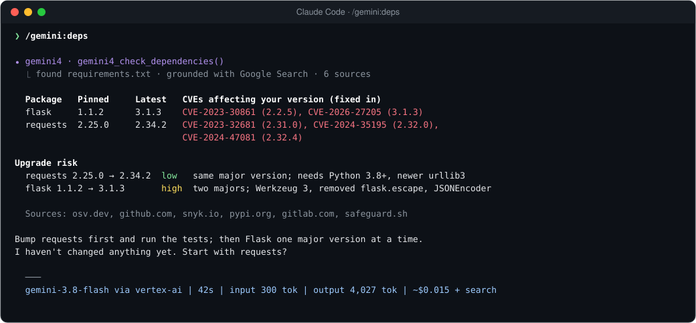
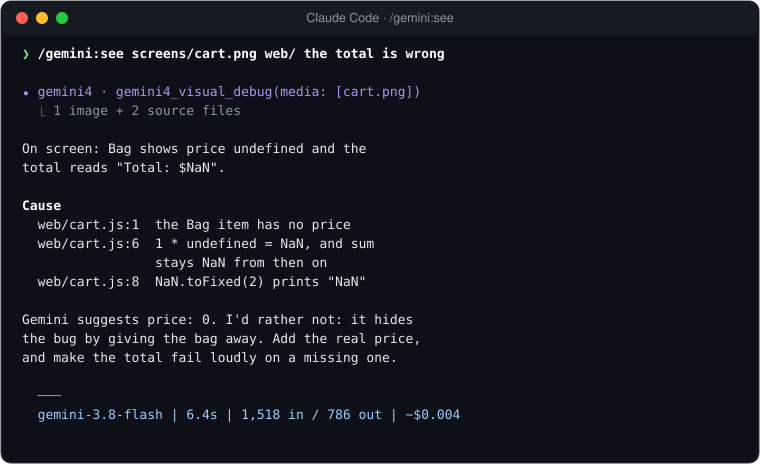

<div align="center">


[](https://github.com/vmishra/gemini-sidecar/actions/workflows/verify.yml)
[](./verify.sh)
[](./LICENSE)

</div>

<p align="center">
  
</p>

That's a real run. One command read this entire repository (39 files, 103K tokens) and returned a cited answer in 16.5 seconds for $0.085. Claude never loaded the files.

## Install

In Claude Code:

```text
/plugin marketplace add vmishra/gemini-sidecar
/plugin install gemini@gemini-sidecar
```

Then give it Gemini access, and restart Claude Code:

```bash
export GEMINI_API_KEY=...            # a key from Google AI Studio
# or, on Google Cloud:
gcloud auth application-default login
export GOOGLE_GENAI_USE_VERTEXAI=true GOOGLE_CLOUD_PROJECT=my-project
```

Run `/gemini:status` to check the setup, then `/gemini:analyze what does this repo do? .` to see it work. Using Codex CLI or Cursor? [Two more lines](#codex-cli-and-cursor).

## Commands

| Command | Use it when you want to… | Example |
|---|---|---|
| `/gemini:analyze` | understand code too big to read yourself | `/gemini:analyze how is auth enforced across services? src/ api/` |
| `/gemini:security-audit` | find vulnerabilities, with CWE IDs and exact lines | `/gemini:security-audit` (audits your uncommitted changes) |
| `/gemini:review` | get a second reviewer before you commit or open a PR | `/gemini:review main` |
| `/gemini:refactor` | make a large multi-file change you can review first | `/gemini:refactor migrate src/db from callbacks to async/await` |
| `/gemini:test-gen` | write tests in your project's own style | `/gemini:test-gen src/billing/invoice.py` |
| `/gemini:test-triage` | find out why tests fail without pasting the log | `/gemini:test-triage pytest -x` |
| `/gemini:docs` | add or fix docstrings without touching behaviour | `/gemini:docs src/utils/` |
| `/gemini:ask-antigravity` | challenge the current plan before you commit to it | `/gemini:ask-antigravity is a queue overkill here?` |
| `/gemini:deps` | find outdated and vulnerable dependencies, from live search | `/gemini:deps` |
| `/gemini:spec-check` | check code against a PDF spec, RFC or API doc | `/gemini:spec-check docs/api-v2.pdf src/api/` |
| `/gemini:see` | debug from a screenshot or screen recording | `/gemini:see screens/checkout.mov src/ui/ total flickers` |
| `/gemini:map` | get an ARCHITECTURE.md onboarding guide for any repo | `/gemini:map` |
| `/gemini:status` | check setup, and see tokens and cost so far | `/gemini:status` |

Options:
- `--deep` on `analyze` uses `gemini-4-argon` instead of `gemini-3.8-flash`.
- `--fast` on `review` does the opposite.
- `--staged` reviews only staged changes.
- `--focus "<area>"` narrows an audit.

The prefix is optional when nothing else uses the name: `/analyze` works. Keep the prefix for `/gemini:review`, because Claude Code has its own built-in `/review`.

<p align="center">
  
</p>

That's `/gemini:security-audit` pointed at this repository's own code. It found six real issues that two earlier code reviews had missed, and all six are fixed in [`038b827`](../../commit/038b827). Claude checks each finding against the cited lines before suggesting any change.

<table>
<tr>
<td width="50%"></td>
<td width="50%"></td>
</tr>
<tr>
<td><code>/gemini:review</code> runs <code>git diff</code> itself and ends with a verdict: SHIP, SHIP WITH FIXES, or DO NOT SHIP.</td>
<td><code>/gemini:refactor</code> writes complete files to a staging folder. Nothing in your tree changes until you say yes.</td>
</tr>
</table>

<sub>Screenshots are real Gemini output from runs on this repository and a small test project, trimmed to fit. Claude's closing remarks are condensed.</sub>

## What Gemini adds that your agent can't do alone

Four commands lean on things Gemini does natively.

**Live search.** `/gemini:deps` checks your dependency files against Google Search results, so CVEs and releases from last week show up, not just what a model learned in training. Every answer lists its sources.

<p align="center">
  
</p>

**Eyes.** `/gemini:see` watches a screenshot or a short screen recording next to your source code and points at the lines behind what's on screen.

<table>
<tr>
<td width="44%"></td>
<td width="56%"></td>
</tr>
<tr><td>What Gemini was shown</td><td>What came back, with the cause in <code>web/cart.js</code></td></tr>
</table>

**Documents.** `/gemini:spec-check` reads a spec natively: a PDF (tables and diagrams included), Markdown, or a URL such as an RFC. It reads the code alongside, then marks each requirement Met, Partial, Missing or Contradicts, with `path:line` evidence.

**A whole repository at once.** `/gemini:map` reads everything that git tracks, up to Gemini's 1M-token context, and writes an `ARCHITECTURE.md` onboarding guide for you to review.

## How it works

<p align="center">
  
</p>

Your agent sends **paths**, not file contents. A small server on your machine reads the files, drops anything secret, and sends the rest to Gemini's 1M-token context. Only the answer comes back. The files never pass through your agent's context window, so they don't crowd out your conversation or get billed again on every later turn.

## Why not just…

**…switch my agent to Gemini with `/model`?** Switching mid-session throws away the prompt cache your conversation has built up. Claude and Gemini also record tool calls differently, so a session can break when its history moves between them. The sidecar leaves your agent and its model alone: Gemini answers one question, and the conversation carries on.

**…let my agent read the files itself?** That works until the code gets big. In the run above, 103K tokens would have filled half of a 200K context window and been billed again on every turn after: about $1.13 over 30 turns with Claude Opus 5.5, against $0.085 here.

**…use the Gemini CLI or Antigravity separately?** You can, but then you're the one copying context and results between two tools. With the sidecar, your agent decides what to ask, sends the right paths, checks the answer and applies the change, all in the same session.

**…paste code into a chat window?** The sidecar does the filtering for you. It sends only files inside your project, skips anything in `.gitignore`, never reads `.env` or key files, and redacts tokens it finds.

## When not to use it

Gemini is a second pair of hands, not a replacement for your agent's own judgement. Skip it when:

- **The file is small.** For one or two files of a few hundred lines, your agent reading them directly is faster than a 5 to 30 second round trip.
- **You're about to edit.** Edits need exact lines, so your agent should read the section it changes itself. The commands answer questions and stage changes; they don't edit in place.
- **The bug is subtle.** Concurrency issues, tricky state and security-critical logic deserve your strongest model's full attention. Use `/gemini:analyze` to find where to look, then reason about it in the main conversation.
- **You need an answer in seconds.** Pro-model audits and refactors take minutes. Add `estimate_only` (the commands do this automatically for big scopes) to see the expected time and cost first.

## Which parts do I need?

<p align="center">
  
</p>

**Most people need only the first install line for their tool.**

<dl>
<dt>MCP server</dt>
<dd>The engine. A single Python file that gives your agent ten tools: analyze, security audit, review diff, refactor (also used for tests, docs and the architecture map), triage failures, check dependencies, spec check, visual debug, ask Antigravity, and status. MCP (Model Context Protocol) is the standard way coding agents call external tools, so Claude Code, Codex CLI and Cursor can all use it. Your agent calls it; you don't.</dd>

<dt>Commands</dt>
<dd>The <code>/gemini:…</code> slash commands in Claude Code. Each is a short recipe that tells Claude which tool to call, with what, and what to do with the answer: verify findings, and ask before applying changes.</dd>

<dt>Subagents</dt>
<dd>Helpers Claude hands tasks to so your main conversation stays focused. <code>gemini-explorer</code> answers "where is X?" by sending big directories to Gemini. <code>gemini-implementer</code> builds a large change in a separate git worktree, then runs your tests. Claude uses them when they fit, or you can ask: "use gemini-explorer to find where retries are configured".</dd>

<dt>Gateway</dt>
<dd>Optional, Claude Code only. It runs Claude Code itself on Gemini models: just the subagents and background calls (Hybrid), or the whole session (All-Gemini). The commands don't need it. <a href="./docs/gateway.md">How the gateway works</a>.</dd>
</dl>

## Measured, not estimated

Each run was made on 3 November 2026 against Vertex AI. Costs use November 2026 list prices.

| Run | Model | Read | Answer | Time | Cost |
|---|---|---:|---:|---:|---:|
| `/gemini:analyze`, this whole repository (39 files) | `gemini-3.8-flash` | 103,003 tok | 1,958 tok | 16.5 s | $0.085 |
| Follow-up question, same files | `gemini-3.8-flash` | 102,988 tok | 573 tok | 8.0 s | $0.079 |
| `/gemini:security-audit`, 3 core files (~3,100 lines) | `gemini-4-argon` | 57,896 tok | 32,223 tok\* | 391 s | $0.44 |
| `/gemini:refactor` with tests, small project | `gemini-4-argon` | 384 tok | 2,817 tok | 45 s | $0.029 |
| `/gemini:review`, one uncommitted change | `gemini-3.8-flash` | 280 tok | 1,984 tok | 16 s | $0.008 |
| `/gemini:test-triage`, one failing suite | `gemini-3.8-flash` | 415 tok | 332 tok | 3.9 s | $0.002 |
| `/gemini:deps`, two pinned packages, with Google Search | `gemini-3.8-flash` | 300 tok | 4,027 tok | 42 s | $0.015 + search |
| `/gemini:spec-check`, PDF spec vs. one module | `gemini-4-argon` | 961 tok | 1,944 tok | 29 s | $0.021 |
| `/gemini:spec-check`, RFC 6585 by URL | `gemini-3.8-flash` | 358 tok | 6,724 tok | 44 s | $0.026 |
| `/gemini:see`, one screenshot + 2 source files | `gemini-3.8-flash` | 1,518 tok | 786 tok | 6.4 s | $0.004 |
| `/gemini:map`, small project | `gemini-4-argon` | 940 tok | 3,257 tok | 52 s | $0.035 |

\*Mostly reasoning. Audits and refactors on `gemini-4-argon` think hard and can take minutes; analysis and triage on Flash take seconds. `/gemini:status` reports the same figures for your own session.

## Codex CLI and Cursor

Both get the same ten tools through the MCP server and keep their own model:

```bash
git clone https://github.com/vmishra/gemini-sidecar.git && cd gemini-sidecar
./install.sh --codex     # adds the server to ~/.codex/config.toml
./install.sh --cursor    # adds it to ~/.cursor/mcp.json, plus two read-only subagents
```

Then ask in plain language: "run gemini4_security_audit on src/auth". To guide each tool on when to use the sidecar:
- **Codex:** copy [`codex/AGENTS.md`](./codex/AGENTS.md) into your project.
- **Cursor:** copy [`cursor/rules/gemini4-coexistence.mdc`](./cursor/rules/gemini4-coexistence.mdc) into `.cursor/rules/`.

`install.sh` backs up every file it changes and supports `--dry-run`. Run `./install.sh --doctor` to check your setup; it never prints secrets.

## Pricing

November 2026 list prices, USD per 1M tokens:

| Model | Input | Cached input | Output (incl. thinking) | Used for |
|---|---:|---:|---:|---|
| `gemini-4-argon` | $2.00 | $0.10 | $10.00 | audits, reviews, refactors, `--deep` |
| `gemini-3.8-flash` | $0.75 | $0.075 | $3.75 | analysis, triage, subagents |
| `gemini-3.5-flash-lite` | $0.30 | $0.03 | $2.50 | gateway background calls |
| `claude-opus-5-5`, for comparison | $4.00 | $0.20 (writes $5.00) | $20.00 | |

Scheduled changes:
- `gemini-4-argon` moves to $4 / $0.20 / $20 on 1 Dec 2026.
- `gemini-3.8-flash` moves to $1.50 / $0.15 / $7.50 on 1 Jan 2027.

`/gemini:deps` also uses Google Search grounding: 5,000 grounded requests a month are free on paid plans, then $14 per 1,000 (not available on the free tier). Reading a URL in `/gemini:spec-check` is billed as ordinary input tokens.

Caching is automatic for repeated prefixes of at least 4,096 tokens on Argon (6,144 on Vertex AI) and 1,024 on Flash, but hits aren't guaranteed. The free tier for Flash models may use your data to improve Google's products, so use a paid key or Vertex AI for proprietary code.

Sources: [Gemini API pricing](https://aistudio.google.com/docs/pricing), [Gemini 4 Argon announcement](https://blog.google/innovation-and-ai/models-and-research/gemini-models/gemini-4-argon/), [Claude pricing](https://platform.claude.com/docs/en/about-claude/pricing), [caching minimums](https://firebase.google.com/docs/ai-logic/context-caching).

## What leaves your machine

File contents go to the Gemini API, or to Vertex AI in your own Google Cloud project, only when a tool runs. Before anything is sent:

- **Only your project.** Paths outside it, `..` and symlinks that escape are rejected. Your home directory or `/` can't be the project.
- **Only what git would commit.** Folders are expanded with `git ls-files`, so `.gitignore` applies.
- **Never secrets.** It never reads `.env*`, `*.pem`, `*.key`, SSH keys, `credentials*`, `*.tfstate`, `.npmrc`, `.netrc` or `.git/`. Tokens for Google, AWS, GitHub, Slack, Stripe, OpenAI and Anthropic, private keys, JWTs and passwords inside URLs are redacted. Each answer says what was excluded.
- **Only the media you name.** `/gemini:see` and `/gemini:spec-check` send just the screenshots, recordings or PDFs you pass, under the same rules. For a spec URL, Google fetches the page; nothing local is sent with it beyond your code paths.
- **No surprise edits.** Generated code goes only to `.gemini4-staging/<run>/`, which is git-ignored.

Details, including the gateway's protections, are in [SECURITY.md](./SECURITY.md) and the [reference](./docs/reference.md).

## More

- [How the gateway works](./docs/gateway.md): run Claude Code's subagents, or the whole session, on Gemini.
- Optional large-read guard: set `GEMINI_SIDECAR_READ_GUARD=suggest` (or `block`) and Claude Code is pointed to `/gemini:analyze` when it tries to read a whole file over 400 lines. Partial reads for edits always pass. Details in the [reference](./docs/reference.md#large-read-guard).
- [Reference](./docs/reference.md): all ten tools, configuration, troubleshooting, development.
- [Contributing](./CONTRIBUTING.md), [Security policy](./SECURITY.md) and [Changelog](./CHANGELOG.md)

Licensed under [Apache 2.0](./LICENSE).
