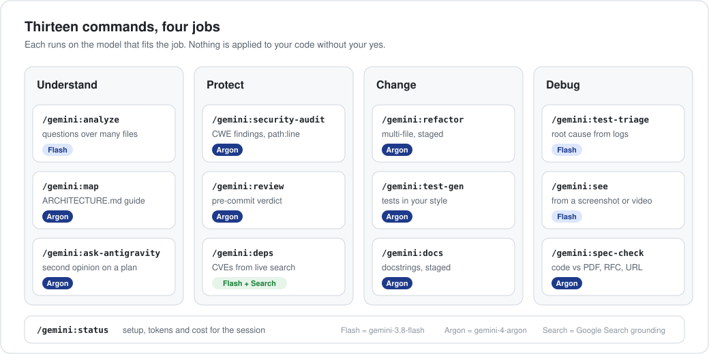
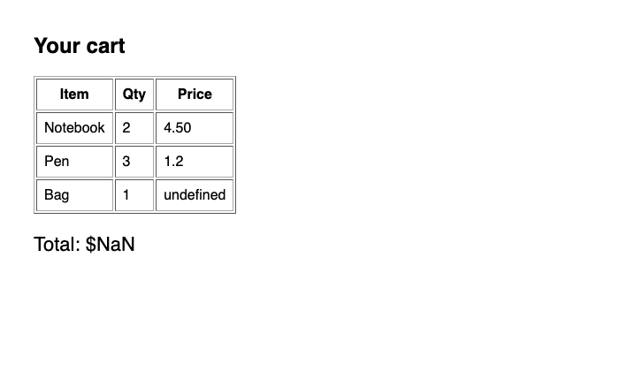

<div align="center">


[](https://github.com/vmishra/gemini-sidecar/actions/workflows/verify.yml)
[](./verify.sh)
[](./LICENSE)

</div>

<p align="center">
  
</p>

That's a real run. One command read this entire repository (39 files, 103K tokens) and returned a cited answer in 16.5 seconds for $0.085. Claude never loaded the files.

## Install

In Claude Code:

```text
/plugin marketplace add vmishra/gemini-sidecar
/plugin install gemini@gemini-sidecar
```

Then give it Gemini access, and restart Claude Code:

```bash
export GEMINI_API_KEY=...            # a paid key from Google AI Studio
# or, on Google Cloud:
gcloud auth application-default login
export GOOGLE_GENAI_USE_VERTEXAI=true GOOGLE_CLOUD_PROJECT=my-project
```

Run `/gemini:status` to check the setup, then `/gemini:analyze what does this repo do? .` to see it work. Using Codex CLI or Cursor? [Two more lines](#codex-cli-and-cursor).

> [!NOTE]
> With a **free-tier** AI Studio key, Google may use your prompts to improve its products. For private code, use a paid key or Vertex AI.

## Commands

<p align="center">
  
</p>

| Command | Use it when you want to… | Example |
|---|---|---|
| `/gemini:analyze` | understand code too big to read yourself | `/gemini:analyze how is auth enforced across services? src/ api/` |
| `/gemini:security-audit` | find vulnerabilities, with CWE IDs and exact lines | `/gemini:security-audit` (audits your uncommitted changes) |
| `/gemini:review` | get a second reviewer before you commit or open a PR | `/gemini:review main` |
| `/gemini:refactor` | make a large multi-file change you can review first | `/gemini:refactor migrate src/db from callbacks to async/await` |
| `/gemini:test-gen` | write tests in your project's own style | `/gemini:test-gen src/billing/invoice.py` |
| `/gemini:test-triage` | find out why tests fail without pasting the log | `/gemini:test-triage pytest -x` |
| `/gemini:docs` | add or fix docstrings without touching behaviour | `/gemini:docs src/utils/` |
| `/gemini:deps` | find outdated and vulnerable dependencies, from live search | `/gemini:deps` |
| `/gemini:spec-check` | check code against a PDF spec, RFC or API doc | `/gemini:spec-check docs/api-v2.pdf src/api/` |
| `/gemini:see` | debug from a screenshot or screen recording | `/gemini:see screens/checkout.mov src/ui/ total flickers` |
| `/gemini:map` | get an ARCHITECTURE.md onboarding guide for any repo | `/gemini:map` |
| `/gemini:ask-antigravity` | challenge the current plan before you commit to it | `/gemini:ask-antigravity is a queue overkill here?` |
| `/gemini:status` | check setup, and see tokens and cost so far | `/gemini:status` |

Options:
- `--deep` on `analyze` uses `gemini-4-carbon` instead of `gemini-3.8-flash`; `--fast` uses `gemini-3.5-flash-lite` for answers in seconds.
- `--fast` on `review` uses `gemini-3.8-flash` instead of `gemini-4-carbon`.
- `--staged` reviews only staged changes.
- `--focus "<area>"` narrows an audit, a dependency check or a spec check.

The prefix is optional when nothing else uses the name, so `/analyze` works. Keep it for `/gemini:review`, because Claude Code has its own built-in `/review`.

## See it work

Every replay below is a real run, trimmed to fit.

**Security audit.** Pointed at this repository's own code, it found six real issues that two earlier code reviews had missed. All six are fixed in [`038b827`](../../commit/038b827).

<p align="center">
  
</p>

**Live dependency check.** Versions and CVEs come from Google Search, not training data, and every answer lists its sources.

<p align="center">
  
</p>

**Debugging from a screenshot.** Gemini looks at the screen and the code together, then points at the line that causes what you see.

<table>
<tr>
<td width="44%"></td>
<td width="56%"></td>
</tr>
<tr><td>What Gemini was shown</td><td>What came back</td></tr>
</table>

**Review and refactor.** Reviews end with a ship verdict. Refactors are written to a staging folder, and nothing in your tree changes until you say yes.

<table>
<tr>
<td width="50%"></td>
<td width="50%"></td>
</tr>
</table>

`/gemini:spec-check` reads a PDF, Markdown spec or URL, such as an RFC, next to your code and marks each requirement Met, Partial, Missing or Contradicts. `/gemini:map` writes an `ARCHITECTURE.md` onboarding guide. Both stage or report only; neither edits your code.

## How it works

<p align="center">
  
</p>

Your agent sends **paths**, not file contents. A small server on your machine reads the files, filters out secrets, and sends the rest to Gemini's 1M-token context. Only the answer comes back. The files never pass through your agent's context window, so they don't crowd out your conversation or get billed again on every later turn.

## Security and privacy

It's built to run on real codebases, which means untrusted code, prompt injection and secrets lying around.

<p align="center">
  
</p>

**What it protects**
- **It only reads your project.** Paths that resolve outside the project folder are refused, including `..` and symlinks that point elsewhere. It won't run with your home directory or `/` as the project.
- **It skips what git ignores, and secret files.** Inside a git repo it sends only what git would track. Ignored files are skipped even when named directly. Files like `.env`, `*.pem`, `*.key` and `credentials*`, and folders like `.ssh/`, `.aws/`, `.kube/`, `.docker/` and `.git/`, are never read.
- **It redacts tokens.** Common formats are removed from everything sent, including your own questions: Google, AWS, GitHub, GitLab, Slack, Stripe, npm, Hugging Face, OpenAI and Anthropic keys, private keys, JWTs, passwords inside URLs, and `password = "…"`-style literals. Each answer lists the secret and ignored files it skipped and how many values it redacted.
- **It never edits your code.** Generated files go only to `.gemini4-staging/`, which is git-ignored. Paths into `.git/` are refused, and staged files that would change CI, hooks or agent settings are flagged for line-by-line review.
- **A malicious repo can't make it run commands.** It runs git with the repository's command-running settings turned off (hooks, fsmonitor, external diff, textconv, filters, pager), and with embedded bare repositories refused. Diffs are forced to text, so `.gitattributes` can't hide a change from review.
- **Commands only run when you type them.** Each command pre-approves only what it needs: its one Gemini tool, plus narrow helpers such as reading files inside the project. The agent can also call the tools on its own, but only through your usual tool-permission prompts.
- **The optional gateway is locked down.** It listens on `127.0.0.1` only and requires a 32+ character token stored in a `0600` file. Requests carrying an `Origin` header or a non-local `Host` are refused, which blocks web pages and DNS rebinding. Request size and concurrent connections are capped, model names are allow-listed before they reach a URL, and prompt text is never logged.
- **It's tested and reviewed.** Over 120 offline tests run on Python 3.9 and 3.13, on Linux and macOS, including a regression test for every security fix. CI actions are pinned to exact commits. Before release, independent adversarial reviews tried to break each guarantee above.

**What you should know**
- **What is sent.** Your code goes to the Gemini API, or to Vertex AI in your own project, whenever a tool runs. Google's terms for that service apply.
- **Media isn't redacted.** Images, recordings and PDFs you pass to `/gemini:see` or `/gemini:spec-check` are sent as they are, and redaction can't see inside them. A spec URL is fetched by Google.
- **Redaction has limits.** It catches well-known formats, not every possible secret. Keep real secrets in ignored or secret-named files.
- **The gateway sends whole conversations.** It forwards complete Claude Code requests (your messages, files Claude has read, tool output) to Gemini without filtering. The protections above cover the `/gemini:` tools, not the gateway.
- **Antigravity is opt-in.** With `GEMINI4_ENABLE_AGY_CLI=1`, `/gemini:ask-antigravity` uses the Antigravity CLI, under that tool's own sign-in and terms. It gets a temporary, redacted copy of the approved files.

Found a problem? Please report it privately; see [SECURITY.md](./SECURITY.md).

## When not to use it

Gemini is a second pair of hands, not a replacement for your agent's own judgement. Skip it when:

- **The file is small.** For one or two files of a few hundred lines, your agent reading them directly is faster than a 5 to 30 second round trip.
- **You're about to edit.** Edits need exact lines, so your agent should read the section it changes itself.
- **The bug is subtle.** Concurrency issues, tricky state and security-critical logic deserve your strongest model's full attention. Use `/gemini:analyze` to find where to look, then reason about it in the main conversation.
- **You need an answer in seconds.** Pro-model audits and refactors take minutes. `/gemini:security-audit`, `/gemini:refactor` and `/gemini:map` preview the cost and time first for big jobs.

## Which parts do I need?

<p align="center">
  
</p>

**Most people need only the first install line for their tool.**

<dl>
<dt>MCP server</dt>
<dd>The engine. A single Python file that gives your agent ten tools: analyze, security audit, review diff, refactor (also used for tests, docs and the architecture map), triage failures, check dependencies, spec check, visual debug, ask Antigravity, and status. MCP (Model Context Protocol) is the standard way coding agents call external tools, so Claude Code, Codex CLI and Cursor can all use it.</dd>

<dt>Commands</dt>
<dd>The <code>/gemini:…</code> slash commands in Claude Code. Each is a short recipe that tells Claude which tool to call, with what, and what to do with the answer, for example checking findings against the cited lines and asking before applying changes.</dd>

<dt>Subagents</dt>
<dd>Helpers Claude hands tasks to so your main conversation stays focused. <code>gemini-explorer</code> answers "where is X?" by sending big directories to Gemini. <code>gemini-implementer</code> builds a large change in a separate git worktree, then runs your tests. Claude uses them when they fit, or you can ask: "use gemini-explorer to find where retries are configured".</dd>

<dt>Gateway</dt>
<dd>Optional, Claude Code only. It runs Claude Code itself on Gemini models: just the subagents and background calls (Hybrid), or the whole session (All-Gemini). The commands don't need it. <a href="./docs/gateway.md">How the gateway works</a>.</dd>
</dl>

## Measured, not estimated

Each run was made on 3 and 4 November 2026 against Vertex AI. Costs use November 2026 list prices.

| Run | Model | Read | Answer | Time | Cost |
|---|---|---:|---:|---:|---:|
| `/gemini:analyze`, this whole repository (39 files) | `gemini-3.8-flash` | 103,003 tok | 1,958 tok | 16.5 s | $0.085 |
| Follow-up question, same files | `gemini-3.8-flash` | 102,988 tok | 573 tok | 8.0 s | $0.079 |
| `/gemini:security-audit`, 3 core files (~3,100 lines) | `gemini-4-argon` | 57,896 tok | 32,223 tok\* | 391 s | $0.44 |
| `/gemini:refactor` with tests, small project | `gemini-4-argon` | 384 tok | 2,817 tok | 45 s | $0.029 |
| `/gemini:review --fast`, one uncommitted change | `gemini-3.8-flash` | 280 tok | 1,984 tok | 16 s | $0.008 |
| `/gemini:test-triage`, 30,006-line log, one failure mid-file | `gemini-3.8-flash` | 21,071 tok | 3,703 tok | 26 s | $0.030 |
| `/gemini:deps`, two pinned packages, with Google Search | `gemini-3.8-flash` | 300 tok | 4,027 tok | 42 s | $0.015 + search |
| `/gemini:spec-check`, PDF spec vs. one module | `gemini-4-argon` | 961 tok | 1,944 tok | 29 s | $0.021 |
| `/gemini:spec-check`, RFC 6585 by URL (page included) | `gemini-4-argon` | 5,591 tok | 2,794 tok | 40 s | $0.039 |
| `/gemini:see`, one screenshot + 2 source files | `gemini-3.8-flash` | 1,518 tok | 786 tok | 6.4 s | $0.004 |
| `/gemini:map`, small project | `gemini-4-argon` | 940 tok | 3,257 tok | 52 s | $0.035 |

\*Mostly reasoning. Audits and refactors on `gemini-4-argon` think hard and can take minutes; analysis and triage on Flash take seconds. `/gemini:status` reports the same figures for your own session.

The triage row shows the log digest at work. Only 766 of the 30,006 lines were sent: every failure, traceback and `file:line`, plus the end of the log, with dropped ranges marked.

## Codex CLI and Cursor

Both get the same ten tools through the MCP server and keep their own model:

```bash
git clone https://github.com/vmishra/gemini-sidecar.git && cd gemini-sidecar
./install.sh --codex     # adds the server to ~/.codex/config.toml
./install.sh --cursor    # adds it to ~/.cursor/mcp.json, plus two read-only subagents
```

Then ask in plain language, for example "run gemini4_security_audit on src/auth". To guide each tool on when to use the sidecar:
- **Codex:** copy [`codex/AGENTS.md`](./codex/AGENTS.md) into your project.
- **Cursor:** copy [`cursor/rules/gemini4-coexistence.mdc`](./cursor/rules/gemini4-coexistence.mdc) into `.cursor/rules/`.

`install.sh` backs up every file it changes, refuses to write through symlinks, and supports `--dry-run`. Run `./install.sh --doctor` to check your setup; it never prints secret values.

## Pricing

November 2026 list prices, USD per 1M tokens:

| Model | Input | Cached input | Output (incl. thinking) | Used for |
|---|---:|---:|---:|---|
| `gemini-4-carbon` | $2.00 | $0.10 | $10.00 | audits, reviews, refactors, spec checks, `--deep` |
| `gemini-3.8-flash` | $0.75 | $0.075 | $3.75 | analysis, triage, deps, see, subagents |
| `gemini-3.5-flash-lite` | $0.30 | $0.03 | $2.50 | gateway background calls |
| `claude-opus-5-5`, for comparison | $4.00 | $0.20 (writes $5.00) | $20.00 | |

Scheduled changes:
- `gemini-4-carbon` moves to $4 / $0.20 / $20 on 1 Dec 2026.
- `gemini-3.8-flash` moves to $1.50 / $0.15 / $7.50 on 1 Jan 2027.

Google Search grounding, used by `/gemini:deps`, is free for 5,000 requests a month on paid plans, then $14 per 1,000. It isn't available on the free tier. A page read by `/gemini:spec-check` is billed as input tokens, and the reported costs include it. Caching is automatic for repeated prefixes of at least 4,096 tokens on Carbon (6,144 on Vertex AI) and 1,024 on Flash, but hits aren't guaranteed.

Sources: [Gemini API pricing](https://aistudio.google.com/docs/pricing), [Gemini 4 Carbon availability](https://blog.google/innovation-and-ai/models-and-research/gemini-models/gemini-4-carbon-now-available/), [Claude pricing](https://platform.claude.com/docs/en/about-claude/pricing), [caching minimums](https://firebase.google.com/docs/ai-logic/context-caching).

## More

- [How the gateway works](./docs/gateway.md): run Claude Code's subagents, or the whole session, on Gemini.
- [Reference](./docs/reference.md): all ten tools, configuration, the cost preview, the optional large-read guard, and troubleshooting.
- [Contributing](./CONTRIBUTING.md), [Security policy](./SECURITY.md) and [Changelog](./CHANGELOG.md).

Licensed under [Apache 2.0](./LICENSE).
