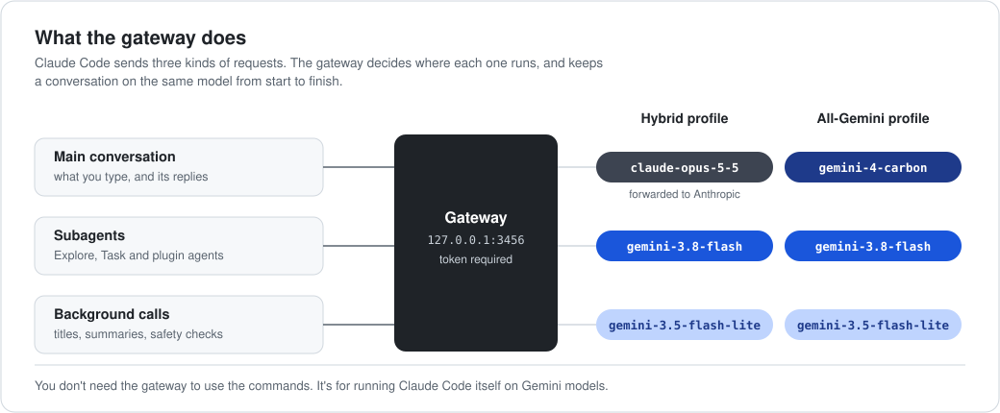

# The gateway (optional)

<p align="center">
  
</p>

You don't need the gateway to use the `/gemini:` commands. It's for running Claude Code itself on Gemini models.

Claude Code sends three kinds of model requests: your main conversation, its subagents, and small background calls. The gateway is a local server that receives them (Claude Code points at it through `ANTHROPIC_BASE_URL`) and sends each one to the model in the table above.

- **Hybrid** keeps Claude Opus 5.5 for your conversation and moves the high-volume work to Gemini. It needs an Anthropic API key for the forwarded requests.
- **All-Gemini** runs everything on Gemini and needs only Gemini credentials.

Either way, a conversation stays on one model from start to finish. Switching models midway would throw away the prompt cache, and Claude and Gemini tool-call histories are not interchangeable.

```bash
# Terminal 1: start the gateway (the first start creates a private token in ~/.config/gemini4/)
export GOOGLE_GENAI_USE_VERTEXAI=true GOOGLE_CLOUD_PROJECT=my-project   # or GEMINI_API_KEY=...
export ANTHROPIC_UPSTREAM_KEY=sk-ant-...                                # Hybrid only
python3 router/gemini4_gateway.py

# Terminal 2: point a project at it and start Claude Code
./install.sh --gateway-profile all-gemini --project ~/code/my-app       # or: hybrid
cd ~/code/my-app && claude
```

Tested end to end with Claude Code on the All-Gemini profile: multi-step read, edit and test tasks completed, subagents ran on `gemini-3.8-flash`, and Gemini's automatic caching showed in the usage data. Limitations:
- Only Claude Code's API (Anthropic Messages) is implemented.
- Gemini replies arrive in one piece rather than streaming word by word.
- Spend caps (`GEMINI4_SESSION_BUDGET_USD`, `GEMINI4_GLOBAL_BUDGET_USD`) are estimates held in memory.

See also: [configuration and troubleshooting](./reference.md).
